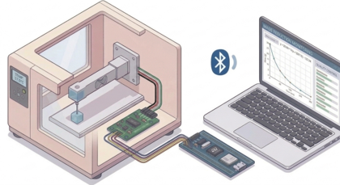
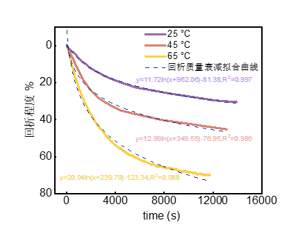
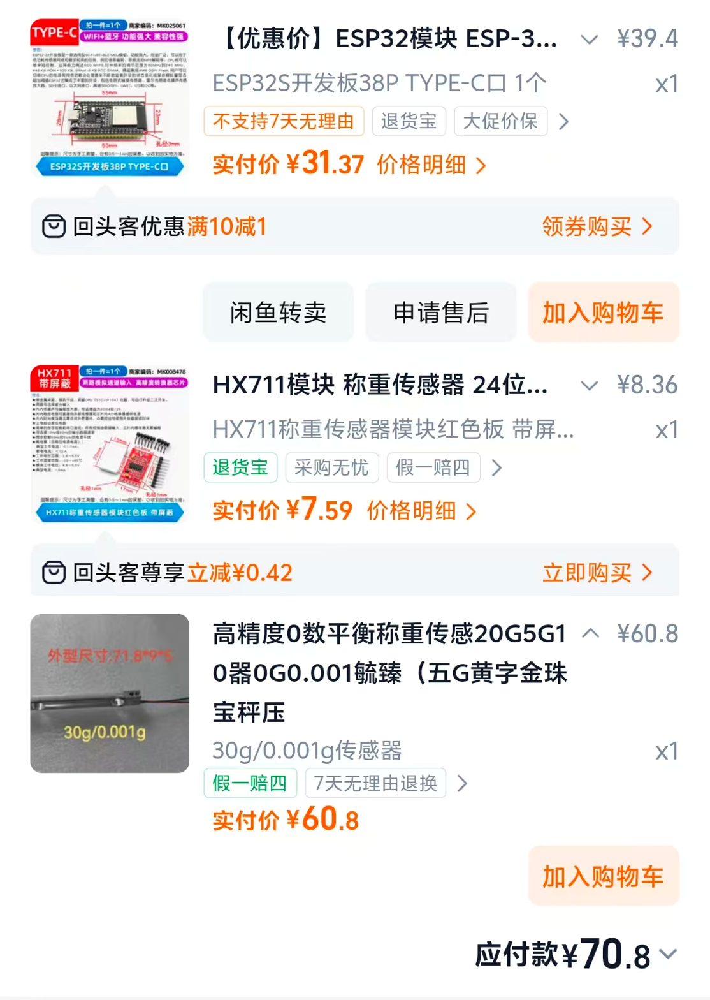

# ESP32 + HX711 Laboratory Sample Mass Monitoring System

English | [简体中文](README_zh-CN.md)

A low-cost (~¥100 / ~$14) solution for **unattended, real-time mass monitoring** of laboratory samples: a load cell is read by the HX711 24-bit ADC, an ESP32 pushes readings to the PC over **Bluetooth**, a PyQt5 desktop app plots the mass curve live and logs everything to CSV, and companion scripts clean the data and fit a logarithmic model. Designed for long-running evaporation / mass-loss / adsorption experiments.



## Features

- **Wireless**: the ESP32 streams a mass reading every 200 ms over Bluetooth SPP — no cable to the PC
- **Live visualization**: dark-themed PyQt5 + pyqtgraph UI with a large live readout and a mass-vs-time curve
- **Automatic logging**: one-click start/stop, an optional session name baked into the CSV file name, adjustable record interval (1–600 s), data written to disk while measuring
- **Multi-point calibration**: up to 16 calibration points with piecewise-linear interpolation; the table lives in the ESP32's NVS storage and **survives power cycles**; managed from a GUI dialog
- **One-click tare** and exponential moving average filtering to suppress jitter
- **Post-processing scripts**: MAD outlier removal + Savitzky-Golay smoothing + downsampling; automatic grid search for the log model `y = a + b·ln(x + c)` (R² > 0.99 on our data)

Measured results (mass-decay curves of three samples with log fits):



## Architecture

```
Load cell ──4 wires──> HX711 (24-bit ADC) ──DT/SCK──> ESP32 ──Bluetooth SPP──> PC host (monitor.py)
                                                       │                          │
                                                       └ Calibration table (NVS)   └ Live curve + CSV
                                                                                   └ clean_data.py / fit_log_model.py
```

## Hardware & Purchasing Reference

| Part | Reference spec | Approx. price |
| --- | --- | --- |
| ESP32 dev board | ESP32S 38-pin Type-C (WiFi + Bluetooth) | ¥31 (~$4.5) |
| HX711 module | 24-bit load-cell ADC, green terminal-block version | ¥8 (~$1.2) |
| Load cell | Range to taste (this project used a 30 g / 0.001 g strain-gauge beam) | ¥62 (~$9) |
| Misc. | Dupont wires, M3 screws, reference weights for calibration | — |

About **¥100 (~$14)** in total. The purchase screenshot (with specs and prices) below reflects what we paid at the time:



> Pick the load-cell range for your sample mass; ideally the sample sits in the 20%–80% band of the range. Smaller range = better resolution, but easier to overload and damage.

## Project Layout

```
├── monitor.py                  # Host app: live monitoring + logging + calibration (PyQt5)
├── clean_data.py               # Post-processing: outlier removal + smoothing + downsampling
├── fit_log_model.py            # Post-processing: log-model fit with automatic grid search
├── process_data.py              # Post-processing: log fit (early version)
├── sketch_apr8c/               # ★ Main firmware: Bluetooth ESP32 + HX711 + NVS calibration table
│   └── sketch_apr8c.ino
├── sketch_apr8b_standard/      # Early firmware: USB-wired minimal version (hard-coded table, reference only)
│   └── sketch_apr8b_standard.ino
├── docs/                       # Images
├── .gitignore
├── LICENSE                     # MIT
├── README.md
└── README_zh-CN.md
```

## Getting Started

### Step 0: Environment Setup

**PC side (host app)** — Python 3.9+:

```bash
pip install pyserial PyQt5 pyqtgraph
```

The post-processing scripts additionally need:

```bash
pip install pandas numpy scipy
```

**Firmware side** — [Arduino IDE](https://www.arduino.cc/en/software) (2.x):

1. Install **esp32 by Espressif Systems** in the Boards Manager (File → Preferences → Additional boards manager URLs: `https://espressif.github.io/arduino-esp32/package_esp32_index.json`, then search and install)
2. Install the **HX711** library by bogde from the Library Manager

### Step 1: Wiring

**HX711 module ↔ ESP32** (4 wires):

| HX711 pin | ESP32 pin | Note |
| --- | --- | --- |
| VCC | 3V3 | Power |
| GND | GND | Common ground |
| DT (DOUT) | **GPIO21** | Data |
| SCK | **GPIO22** | Clock |

**Load cell ↔ HX711** (4 signal wires; wire colors vary by vendor — always check your sensor's datasheet):

| Load-cell wire (typical color) | HX711 terminal |
| --- | --- |
| Red | E+ |
| Black | E− |
| Green | A+ |
| White | A− |

Wiring notes:

- Small-range load cells (e.g. 30 g) are fragile — **never press them by hand or overload them**; mount a beam cell with screws on one side and load the other
- Tighten the mounting screws gently; over-tightening causes reading drift
- Keep the HX711 close to the load cell; long wires pick up noise

### Step 2: Flash the Firmware

1. Connect the ESP32 to the PC over USB
2. Open `sketch_apr8c/sketch_apr8c.ino`
3. In the Arduino IDE select:
   - Board: **ESP32S Dev Module** (or ESP32 Dev Module)
   - Port: the COM port of the ESP32
4. Click Upload and wait for the build/flash to finish

Once flashed, the firmware runs automatically and advertises Bluetooth as **`Lab_Scale_ESP32`**.

> `sketch_apr8b_standard/` is an early USB-wired minimal version (hard-coded calibration table, only R/T commands, no streaming). It does **not** work with monitor.py and is kept for reference only.

### Step 3: Connectivity Test

Verify each link of the chain in order:

1. **Test the HX711**: open the Arduino Serial Monitor at 115200 baud, press the ESP32's RST button, and you should see:
   ```
   Bluetooth started! Device name: Lab_Scale_ESP32
   Checking HX711...
   HX711 initialized!
   ```
   If it prints `HX711 missing or faulty! Skipping initial tare.`, go back and re-check the Step 1 wiring and power.
2. **Find the Bluetooth serial port**: no pairing code is involved. With the PC's Bluetooth on and the ESP32 powered, open Device Manager → Ports (COM & LPT): two `Lab_Scale_ESP32` serial ports appear. Note the one marked **Outgoing** (e.g. `COM5`) — monitor.py talks over that port.
   - You can also send `T` to that COM port with any serial terminal (e.g. sscom); an `OK` reply confirms two-way communication.

### Step 4: Run the Host App and Take a Baseline

```bash
python monitor.py
```

1. **Connect**: pick the Bluetooth COM port noted above, baud 115200, click "Connect Device (Bluetooth/Serial)". The large readout should start updating.
2. **No-load baseline**: leave the pan empty, click "⚖️ Tare Sensor", and let it sit for 5–10 minutes:
   - The reading should stay near 0; a steady one-way drift points to mounting screws, airflow (AC/fan draft) or desk vibration
3. **Accuracy baseline**: place a known reference weight (e.g. 5.000 g), wait ~10 s for the reading to settle, and compare:
   - Error acceptable → baseline passed, start experimenting
   - Clearly off → calibrate (next step)

### Step 5: Calibration (optional, recommended once after assembly)

Open "⚙️ Calibration Manager" and build a gradient table from reference weights:

1. Empty pan → "Read Current Raw" → enter `0` as the weight → "Add This Point (A)"
2. Place a 2.000 g weight → Read Raw → enter `2` → Add
3. Repeat with 5.000 g, 10.000 g, … (at least 3 non-zero points covering your working range; max 16)
4. "List All (L)" to double-check the table → "Save to Device (S)"

The table is written to the ESP32's NVS and **survives reboots**. "Reset Default (C)" clears it anytime.

### Step 6: Usage Example — a Full Mass-Loss Experiment

1. Place the sample on the pan, let the reading settle, tare if needed
2. Enter a session name (e.g. `sample1_evaporation`), set the record interval to `60` s
3. Click "▶ Start Monitoring" — the curve starts growing and the CSV is written live
4. Click "⏸ Stop & Save" when done; you get `sample1_evaporation_20260425_163058.csv` in the script folder:

   | timestamp | time_s | weight_g |
   | --- | --- | --- |
   | 16:30:58 | 0.0 | 5.842 |
   | 16:31:58 | 60.0 | 5.837 |

5. Post-process the CSV (edit the file names at the bottom of the scripts):

```bash
# Clean: MAD outlier removal + median/Savitzky-Golay smoothing + downsampling
python clean_data.py     # -> cleaned_data.csv

# Fit: log model y = a + b·ln(x+c) with automatic search; prints formula and R²
python fit_log_model.py  # -> optimized.csv
```

The fits shown in the "Sample data" figure above: three log-decay curves, all with R² > 0.99.

## Serial Protocol

The host and firmware speak a plain line-based text protocol (`\n`-terminated, 115200 baud); you can drive the device from any serial terminal:

| Command | Action | Device reply |
| --- | --- | --- |
| `T` | Tare (zero the current reading) | `OK` |
| `R` | Read the current raw ADC value | `RAW:123456` or `RAW:ERROR` |
| `A <raw> <weight>` | Add a calibration point, e.g. `A 104820 2.89` | `ADDED` / `FULL` / `Usage: A <raw> <weight>` |
| `L` | List the calibration table | `--- CAL TABLE ---` … `--- END ---` |
| `S` | Save the calibration table to NVS | `SAVED` / `NO CHANGE` |
| `C` | Clear the table and restore defaults | `CLEARED` |

With no command pending, the device streams one mass value per line every 200 ms (e.g. `5.842`), or `HX711_ERROR` when the sensor is not ready. Weight is computed by **piecewise-linear interpolation** of the calibration table; beyond the last point it extrapolates with the final segment's slope.

## Troubleshooting

- **No ports in the dropdown**: for USB, install the board's serial driver first (CH340 / CP210x); for Bluetooth, make sure the PC's Bluetooth is on and the ESP32 is powered, then hit "🔄 Refresh".
- **Connected but the value never updates**: you probably picked the Bluetooth **Incoming** port — switch to the other one; or the ESP32 lost power / the link dropped — reset the device and reconnect.
- **Steady reading drift**: let a new sensor warm up for 10–20 minutes; shield it from airflow; check whether the mounting screws are over-tightened.
- **Jumpy readings / noisy curve**: the host app already applies exponential smoothing (`filter_alpha = 0.1`; smaller = steadier but slower). If spikes remain, move away from vibration sources or clean the data afterwards with `clean_data.py`.
- **Still inaccurate after calibrating**: make sure the calibration points cover your actual working range; several points from light to heavy beat any single-point ratio calibration; if needed, `C` to reset and redo.
- **macOS / Linux**: the Bluetooth SPP port is named like `/dev/tty.Lab_Scale_ESP32`; the "Open Data Folder" button is Windows-only (`os.startfile`).

## Acknowledgments

- The firmware depends on the [bogde/HX711](https://github.com/bogde/HX711) library; the UI is built with PyQt5 and pyqtgraph.
- This is a hobby-grade lab instrument: accuracy depends on the load-cell grade, mounting stress and environment. **Do not use it for safety-critical weighing.**

<!-- TODO (before release):
- Citation info if this helps your research
- Photos of the actual build
-->

## License

Released under the [MIT](LICENSE) license.
