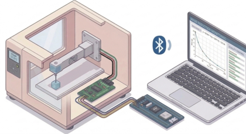
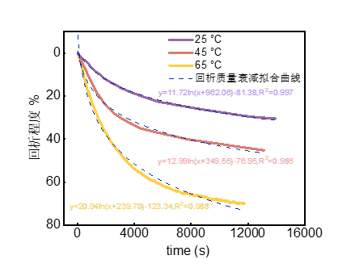
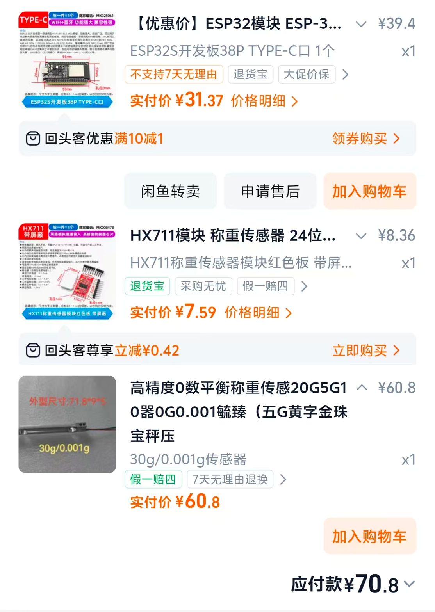

# ESP32 + HX711 实验室样品质量无人监测系统

[English](README.md) | 简体中文

> 注：为便于国际用户使用，代码注释、上位机界面与固件串口输出均为英文，本文档中的按钮/输出名称以英文为准并附中文说明。

一套低成本（整机约 ¥100）的实验室样品质量**实时无人监测**方案：称重传感器经 HX711 采集后由 ESP32 通过**蓝牙**无线推送到电脑，上位机实时绘制质量变化曲线并自动记录 CSV，配套脚本完成数据清洗与对数模型拟合，适用于样品蒸发/失重/吸附等长时间质量变化实验。



## 功能特性

- **无线监测**：ESP32 经蓝牙串口（SPP）每 200 ms 推送一次质量读数，电脑无需连线
- **实时可视化**：PyQt5 + pyqtgraph 暗色界面，大字号实时读数 + 质量-时间曲线
- **自动记录**：一键开始/停止监测，支持自定义实验备注名（自动拼入文件名）、可调记录间隔（1–600 秒），边测边写 CSV
- **多点梯度校准**：支持最多 16 个校准点的分段线性校准，校准表保存在 ESP32 的 NVS 中**断电不丢失**，上位机图形化管理
- **一键去皮**、指数滑动平均滤波（抑制读数抖动）
- **数据后处理脚本**：MAD 异常值剔除 + Savitzky-Golay 平滑降采样；对数模型 `y = a + b·ln(x + c)` 自动寻优拟合（网格搜索平滑窗口与采样步长，R² > 0.99）

实测效果（三组样品的质量衰减曲线及对数拟合）：



## 系统架构

```
称重传感器 ──4线──> HX711 (24位ADC) ──DT/SCK──> ESP32 ──蓝牙SPP──> PC 上位机 monitor.py
                                                  │                    │
                                                  └ 校准表存于 NVS       └ 实时曲线 + CSV
                                                                       └ clean_data.py / fit_log_model.py 后处理
```

## 硬件清单与购买参考

| 器件 | 规格参考 | 参考单价 |
| --- | --- | --- |
| ESP32 开发板 | ESP32S 38Pin Type-C（带 WiFi + 蓝牙） | ¥31 左右 |
| HX711 模块 | 24 位称重专用 ADC，绿色接线端子款 | ¥8 左右 |
| 称重传感器 | 量程按需选择（本项目用 30 g / 0.001 g 量程电阻应变式悬臂梁） | ¥62 左右 |
| 杂项 | 杜邦线、M3 螺丝、砝码（校准用） | 若干 |

合计约 **¥100**。购买截图（含规格与价格明细）见下图，价格仅为当时参考：



> 传感器量程请按样品质量选择，建议样品质量落在量程的 20%–80% 区间以保证精度；量程越小精度越高，但越容易过载损坏。

## 目录结构

```
├── monitor.py                  # 上位机：实时监测 + 记录 + 校准管理（PyQt5）
├── clean_data.py               # 数据后处理：异常值剔除 + 平滑 + 降采样（原 处理.py）
├── fit_log_model.py            # 数据后处理：对数模型寻优拟合（原 数据提取.py）
├── process_data.py              # 数据后处理：对数拟合（早期版本）
├── sketch_apr8c/               # ★ 主固件：蓝牙版 ESP32 + HX711 + NVS 校准表
│   └── sketch_apr8c.ino
├── sketch_apr8b_standard/      # 早期固件：USB 有线简化版（校准表写死在代码里，仅供参考）
│   └── sketch_apr8b_standard.ino
├── docs/                        # 图片资料
├── .gitignore
├── LICENSE                      # MIT 许可证
├── README.md                    # 英文说明
└── README_zh-CN.md              # 中文说明（本文件）
```

## 快速开始

### 第 0 步：环境准备

**电脑端（上位机）** — Python 3.9+：

```bash
pip install pyserial PyQt5 pyqtgraph
```

数据后处理脚本另需：

```bash
pip install pandas numpy scipy
```

**固件端** — [Arduino IDE](https://www.arduino.cc/en/software)（2.x）：

1. 在「开发板管理器」中安装 **esp32 by Espressif Systems**（文件 → 首选项 → 附加开发板管理器网址填入 `https://espressif.github.io/arduino-esp32/package_esp32_index.json` 后再搜索安装）
2. 在「库管理器」中搜索并安装 **HX711**（bogde 版）

### 第 1 步：设备接线

**HX711 模块 ↔ ESP32**（共 4 根线）：

| HX711 引脚 | ESP32 引脚 | 说明 |
| --- | --- | --- |
| VCC | 3V3 | 供电 |
| GND | GND | 共地 |
| DT（DOUT） | **GPIO21** | 数据线 |
| SCK | **GPIO22** | 时钟线 |

**称重传感器 ↔ HX711**（4 根信号线，颜色以你手上传感器商家的接线图为准）：

| 传感器线（常见颜色） | HX711 端子 |
| --- | --- |
| 红 | E+ |
| 黑 | E− |
| 绿 | A+ |
| 白 | A− |

接线注意事项：

- 小量程传感器（如 30 g）非常脆弱，**切勿用手按压或超量程加载**；悬臂梁传感器一端螺丝固定、一端加载
- 拧紧传感器螺丝时力度适中，用力过度会导致读数漂移
- HX711 尽量靠近传感器，避免长线引入干扰

### 第 2 步：烧录固件

1. 用 USB 线连接 ESP32 与电脑
2. 打开 `sketch_apr8c/sketch_apr8c.ino`
3. Arduino IDE 中选择：
   - 开发板：**ESP32S Dev Module**（或 ESP32 Dev Module）
   - Port：ESP32 对应的 COM 口
4. 点击「上传」，等待编译烧录完成

固件烧录成功后 ESP32 会自动运行，蓝牙广播名为 **`Lab_Scale_ESP32`**。

> `sketch_apr8b_standard/` 是早期 USB 有线简化版（校准表硬编码、仅支持 R/T 两条指令、不主动推送数据），**不能配合 monitor.py 使用**，仅留作参考。

### 第 3 步：连通性测试

按以下顺序确认链路每一环都通：

1. **测试 HX711**：Arduino IDE 打开串口监视器（波特率 115200），按一下 ESP32 的 RST 复位键，应看到：
   ```
   Bluetooth started! Device name: Lab_Scale_ESP32
   Checking HX711...
   HX711 initialized!
   ```
   若显示 `HX711 missing or faulty! Skipping initial tare.`，请回头检查第 1 步接线与供电。
2. **确认蓝牙串口**：固件无需配对码。确保电脑蓝牙已开启、ESP32 已上电，打开「设备管理器 → 端口(COM 和 LPT)」，会出现两个 `Lab_Scale_ESP32` 串行端口，记下标有**传出（Outgoing）**的那个 COM 号（如 `COM5`）。与 monitor.py 通信要用这个口。
   - 也可用串口调试助手（如 sscom）向该 COM 口发送 `T`，收到 `OK` 即说明双向通信正常。

### 第 4 步：运行上位机并做基线测试

```bash
python monitor.py
```

1. **连接设备**：端口号选择上一步记下的蓝牙 COM 口，波特率 115200，点击「Connect Device (Bluetooth/Serial)」（连接设备）。连接成功后界面大数字应开始实时刷新。
2. **空载基线**：让托盘空载，点击「⚖️ Tare Sensor」（去皮），静置观察 5–10 分钟：
   - 读数应基本稳定在 0 附近；若持续单向漂移，检查传感器固定螺丝、气流（空调/风扇直吹）与桌面震动
3. **精度基线**：放上一个已知质量的标准砝码（如 5.000 g），等待 10 秒读数稳定后与标准值对比：
   - 误差在可接受范围内 → 基线通过，可直接开始实验
   - 偏差明显 → 进行下面的校准

### 第 5 步：校准（可选，建议首次使用时做一次）

点击「⚙️ Calibration Manager」（校准管理），用实验室砝码建立梯度校准表：

1. 托盘空载 → 点击「Read Current Raw」（读取当前 Raw）→ 重量填 `0` → 「Add This Point (A)」（添加此点）
2. 放上 2.000 g 砝码 → 读取 Raw → 重量填 `2` → 添加
3. 换 5.000 g、10.000 g …… 重复（建议至少 3 个非零点、覆盖常用量程，最多 16 点）
4. 点击「List All (L)」（列出全部）确认校准表无误 → 点击「Save to Device (S)」（保存到设备）

保存后校准表写入 ESP32 的 NVS 存储，**断电重启依然生效**。「Reset Default (C)」（恢复默认）可随时清空重来。

### 第 6 步：使用示例 —— 一轮完整的失重监测实验

1. 将样品放上传感器托盘，等待读数稳定，按需去皮
2. 「Session name」（数据备注）填入实验名（如 `sample1_evaporation`），「Record/plot interval (s)」（记录间隔）设为 `60` 秒
3. 点击「▶ Start Monitoring」（开始监测）——右侧曲线开始生长，CSV 同步落盘
4. 实验结束点击「⏸ Stop & Save」（停止并保存），在脚本目录得到 `sample1_evaporation_20260425_163058.csv`：

   | timestamp | time_s | weight_g |
   | --- | --- | --- |
   | 16:30:58 | 0.0 | 5.842 |
   | 16:31:58 | 60.0 | 5.837 |

5. 对 CSV 做后处理（把脚本末尾的文件名换成你自己的）：

```bash
# 清洗：MAD 剔除异常值 + 中值/S-G 平滑 + 降采样
python clean_data.py     # 输出 cleaned_data.csv

# 拟合：对数模型 y = a + b·ln(x+c) 自动寻优，输出平滑值与拟合值
python fit_log_model.py  # 输出 optimized.csv，控制台打印拟合公式与 R²
```

拟合效果即上方「示例数据」一图：三条对数衰减曲线 R² 均大于 0.99。

## 串口指令协议

上位机与固件之间为纯文本行协议（`\n` 结尾，115200），你也可以用任意串口工具直接调试：

| 指令 | 功能 | 设备返回 |
| --- | --- | --- |
| `T` | 去皮（当前读数归零） | `OK` |
| `R` | 读取当前原始 ADC 值 | `RAW:123456` 或 `RAW:ERROR` |
| `A <raw> <weight>` | 添加校准点，如 `A 104820 2.89` | `ADDED` / `FULL` / `Usage: A <raw> <weight>` |
| `L` | 列出校准表 | `--- CAL TABLE ---` … `--- END ---` |
| `S` | 保存校准表到 NVS | `SAVED` / `NO CHANGE` |
| `C` | 清空校准表并恢复默认 | `CLEARED` |

无指令时设备每 200 ms 推送一行质量数值（如 `5.842`）；传感器未就绪时推送 `HX711_ERROR`。重量由校准表**分段线性插值**得到，超出最大校准点后按末段斜率外推。

## 常见问题

- **下拉框里找不到串口**：USB 连接请先装好开发板串口驱动（CH340 / CP210x）；蓝牙串口需电脑蓝牙已开启且 ESP32 已上电，点上位机的「🔄 Refresh」刷新。
- **连接后数值不刷新**：多半选了蓝牙的「传入 (Incoming)」端口，换另一个；或 ESP32 已断电 / 蓝牙断开，复位设备后重连。
- **读数持续漂移**：新传感器上电预热 10–20 分钟；屏蔽气流；检查传感器固定螺丝是否拧过头。
- **读数跳变 / 曲线毛刺**：上位机已内置指数平滑（`filter_alpha = 0.1`，越小越稳但越迟钝），仍有毛刺可远离震动源，或后处理时用 `clean_data.py` 清洗。
- **校准后仍不准**：确认校准点覆盖了实际使用量程；砝码从轻到重覆盖多个点比单点比例校准准得多；必要时 `C` 清空重做。
- **macOS / Linux**：蓝牙 SPP 端口名形如 `/dev/tty.Lab_Scale_ESP32`；「Open Data Folder」按钮目前仅支持 Windows（`os.startfile`）。

## 说明与致谢

- 固件依赖 [bogde/HX711](https://github.com/bogde/HX711) 库，界面基于 PyQt5 与 pyqtgraph。
- 本项目为实验室自用仪器脚本，精度受传感器等级、安装应力与环境影响，**请勿用于对安全性有要求的关键称重场合**。

<!-- TODO（发布前补充）：
- 若对科研有帮助的引用方式
- 实物照片 / 装配实拍
-->

## License

本项目基于 [MIT](LICENSE) 许可证开源。
